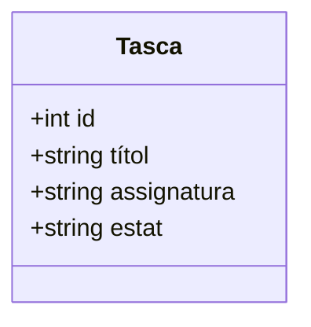

# SPECIFICATIONS.md — Sistema Tasks_app (v1.0)

## 0. Historial de versions
| Versió | Sprint | Canvis incorporats | Estat |
|--------|--------|--------------------|-------|
| v1.0 | Inicial | US-01, US-02; RF-01..RF-04; GS-01..GS-03 | en curs |

## 1. Visió General
Tasks_app és una eina CLI lleugera per ajudar als estudiants a gestionar les seves tasques acadèmiques diàries.

## 2. User Stories (Històries d'Usuari)
- US-01 [v1.0]: Com a estudiant, vull afegir una tasca amb títol i assignatura per tal de recordar els meus deures.
- US-02 [v1.0]: Com a estudiant, vull veure la llista de tasques registrades per tal d'organitzar el meu temps.

## 3. Model de Dades (Mermaid)

## 4. Requisits
- RF-01 [v1.0]: El sistema tasks_app ha de guardar les tasques en un fitxer JSON de persistència local.
- RF-02 [v1.0]: Si el fitxer `data/tasks.json` no existeix, el sistema tasks_app ha de crear `data/tasks.json` inicialitzat amb una llista JSON buida (`[]`).
- RF-03 [v1.0]: El sistema tasks_app ha de proveir a l'estudiant la capacitat de crear una nova tasca amb estat 'pendent' mitjançant el comandament `add --title <títol> --subject <assignatura>`.
- RF-04 [v1.0]: El sistema tasks_app ha de proveir a l'estudiant la capacitat de visualitzar totes les tasques registrades (incloent-hi el seu ID, títol, assignatura i estat) mitjançant el comandament `list`.

## 5. Criteris d'acceptació i proves (Gherkin scenarios)
- GS-01 [v1.0]: Creació correcta d'una tasca (verifica RF-01, RF-03)
  Atès que la base de dades JSON no conté encara tasques
  quan l'estudiant executa `python src/tasks_app.py add --title 'Pràctica 1' --subject 'RS'`
  aleshores el sistema confirma `Tasca [ID: 1] creada amb èxit`
  i la tasca queda registrada al fitxer `data/tasks.json`.

- GS-02 [v1.0]: Llistat de tasques quan `data/tasks.json` no conté registres (verifica RF-02, RF-04)
  Atès que la base de dades JSON no conté encara tasques
  quan l'estudiant executa `python src/tasks_app.py list`
  aleshores el sistema mostra `Registre de tasques buit.`

- GS-03 [v1.0]: Llistat de tasques quan `data/tasks.json` conté registres (verifica RF-04)
  Atès que el fitxer `data/tasks.json` conté les següents tasques:
    | id | títol          | assignatura | estat   |
    | 1  | Pràctica 1     | RS          | pendent |
    | 2  | Examen parcial | SO          | pendent |
  quan l'estudiant executa `python src/tasks_app.py list`
  aleshores el sistema mostra per pantalla:
    "[1] Pràctica 1 (RS) - estat: pendent"
    "[2] Examen parcial (SO) - estat: pendent"
