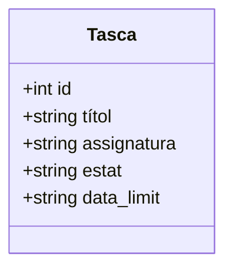
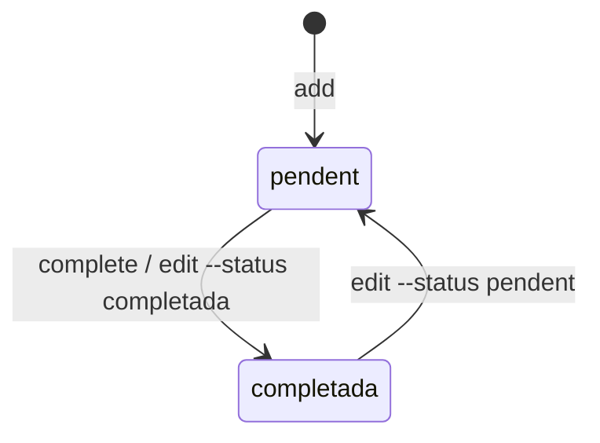

# SPECIFICATIONS.md — Sistema Tasks_app (v2.0)

## 0. Historial de versions
| Versió | Sprint | Canvis incorporats | Estat |
|--------|--------|--------------------|-------|
| v1.0 | Inicial | US-01, US-02; RF-01..RF-04; GS-01..GS-03 | completada |
| v2.0 | Sprint 2 | Afegits US-03..US-06; RF-05..RF-14 (data límit, edició, completat, indicadors); RNF-01..RNF-05; GS-04..GS-17; camp `data_limit` i estat `completada` al model; glossari i matriu de traçabilitat. Els requisits i escenaris de la v1.0 no canvien. | en curs |

## 1. Visió General
Tasks_app és una eina CLI lleugera per ajudar als estudiants a gestionar les seves tasques acadèmiques diàries.

## 2. User Stories (Històries d'Usuari)
- US-01 [v1.0]: Com a estudiant, vull afegir una tasca amb títol i assignatura per tal de recordar els meus deures.
- US-02 [v1.0]: Com a estudiant, vull veure la llista de tasques registrades per tal d'organitzar el meu temps.
- US-03 [v2.0]: Com a estudiant, vull indicar una data límit en afegir una tasca per tal de saber quan l'he de lliurar.
- US-04 [v2.0]: Com a estudiant, vull modificar qualsevol atribut d'una tasca a partir del seu ID per tal de corregir els errors comesos en registrar-la.
- US-05 [v2.0]: Com a estudiant, vull indicar que una tasca s'ha completat per tal de distingir el que ja he fet del que em queda per fer.
- US-06 [v2.0]: Com a estudiant, vull que el llistat marqui les tasques caducades i les urgents per tal de prioritzar el meu temps.

## 3. Model de Dades (Mermaid)

A la v2.0, `estat` pren els valors `pendent` o `completada`, i `data_limit` és opcional amb format YYYY-MM-DD.

Cicle de vida de l'estat d'una tasca (v2.0):

## 4. Requisits
- RF-01 [v1.0]: El sistema tasks_app ha de guardar les tasques en un fitxer JSON de persistència local.
- RF-02 [v1.0]: Si el fitxer `data/tasks.json` no existeix, el sistema tasks_app ha de crear `data/tasks.json` inicialitzat amb una llista JSON buida (`[]`).
- RF-03 [v1.0]: El sistema tasks_app ha de proveir a l'estudiant la capacitat de crear una nova tasca amb estat 'pendent' mitjançant el comandament `add --title <títol> --subject <assignatura>`.
- RF-04 [v1.0]: El sistema tasks_app ha de proveir a l'estudiant la capacitat de visualitzar totes les tasques registrades (incloent-hi el seu ID, títol, assignatura i estat) mitjançant el comandament `list`.

### 4.1 Requisits funcionals de la v2.0
- RF-05 [v2.0]: El sistema tasks_app ha de proveir a l'estudiant la capacitat de registrar la data límit d'una tasca mitjançant l'opció `--due YYYY-MM-DD` del comandament `add`.
- RF-06 [v2.0]: Si la data indicada amb l'opció `--due` dels comandaments `add` o `edit` no té el format YYYY-MM-DD o no és una data de calendari vàlida, el sistema tasks_app ha de rebutjar l'operació mostrant el missatge `Error: format de data invàlid (YYYY-MM-DD).`
- RF-07 [v2.0]: El sistema tasks_app ha de proveir a l'estudiant la capacitat de modificar el títol, l'assignatura, la data límit o l'estat d'una tasca identificada pel seu ID mitjançant el comandament `edit --id <ID>` amb les opcions `--title`, `--subject`, `--due` i `--status` (valors `pendent` o `completada`), i confirmar-ho amb el missatge `Tasca [ID: <ID>] modificada amb èxit`.
- RF-08 [v2.0]: Si l'ID indicat als comandaments `edit` o `complete` no correspon a cap tasca registrada, el sistema tasks_app ha de mostrar el missatge `Error: no existeix cap tasca amb ID <ID>.`
- RF-09 [v2.0]: Si l'estudiant executa el comandament `edit` sense cap de les opcions `--title`, `--subject`, `--due` o `--status`, el sistema tasks_app ha de mostrar el missatge `Error: cal indicar almenys un atribut a modificar.`
- RF-10 [v2.0]: El sistema tasks_app ha de proveir a l'estudiant la capacitat de marcar una tasca com a completada mitjançant el comandament `complete --id <ID>`, i confirmar-ho amb el missatge `Tasca [ID: <ID>] marcada com a completada`.
- RF-11 [v2.0]: Si la tasca indicada al comandament `complete` ja té l'estat `completada`, el sistema tasks_app ha de mostrar el missatge `La tasca [ID: <ID>] ja estava completada.` sense modificar `data/tasks.json`.
- RF-12 [v2.0]: Quan una tasca té data límit, el sistema tasks_app ha de mostrar, en el comandament `list`, el text ` - límit: <data>` just després de l'estat de la tasca.
- RF-13 [v2.0]: Si una tasca pendent té una data límit anterior a la data actual, el sistema tasks_app ha de mostrar, en el comandament `list`, l'indicador `[CADUCADA]` al final de la línia de la tasca.
- RF-14 [v2.0]: Si una tasca pendent té una data límit que caduca en menys de 7 dies (és a dir, entre 0 i 6 dies, ambdós inclosos, a comptar des de la data actual), el sistema tasks_app ha de mostrar, en el comandament `list`, l'indicador `[URGENT]` al final de la línia de la tasca.

### 4.2 Requisits no funcionals de la v2.0
- RNF-01 [v2.0]: El sistema tasks_app ha de carregar sense errors un fitxer `data/tasks.json` creat per la v1.0 (tasques sense el camp `data_limit`) i ha de tractar aquestes tasques com a tasques sense data límit.
- RNF-02 [v2.0]: El sistema tasks_app ha d'utilitzar únicament la biblioteca estàndard de Python 3.11 (`pytest` només per als tests).
- RNF-03 [v2.0]: Si es produeix un error, el sistema tasks_app ha d'escriure el missatge d'error per la sortida d'errors, ha de finalitzar amb el codi de sortida 1 i no ha de modificar `data/tasks.json`.
- RNF-04 [v2.0]: El sistema tasks_app ha de desar `data/tasks.json` en codificació UTF-8 i les dates en format ISO 8601 (YYYY-MM-DD).
- RNF-05 [v2.0]: Si el fitxer `data/tasks.json` no conté JSON vàlid, el sistema tasks_app ha de mostrar el missatge `Error: el fitxer data/tasks.json no conté JSON vàlid.` sense sobreescriure'l.

## 5. Criteris d'acceptació i proves (Gherkin scenarios)
- GS-01 [v1.0]: Creació correcta d'una tasca (verifica RF-01, RF-03)
  Atès que la base de dades JSON no conté encara tasques
  quan l'estudiant executa `python src/tasks_app.py add --title 'Pràctica 1' --subject 'RS'`
  aleshores el sistema confirma `Tasca [ID: 1] creada amb èxit`
  i la tasca queda registrada al fitxer `data/tasks.json`.

- GS-02 [v1.0]: Llistat de tasques quan `data/tasks.json` no conté registres (verifica RF-02, RF-04)
  Atès que la base de dades JSON no conté encara tasques
  quan l'estudiant executa `python src/tasks_app.py list`
  aleshores el sistema mostra `Registre de tasques buit.`

- GS-03 [v1.0]: Llistat de tasques quan `data/tasks.json` conté registres (verifica RF-04)
  Atès que el fitxer `data/tasks.json` conté les següents tasques:
    | id | títol          | assignatura | estat   |
    | 1  | Pràctica 1     | RS          | pendent |
    | 2  | Examen parcial | SO          | pendent |
  quan l'estudiant executa `python src/tasks_app.py list`
  aleshores el sistema mostra per pantalla:
    "[1] Pràctica 1 (RS) - estat: pendent"
    "[2] Examen parcial (SO) - estat: pendent"

### 5.1 Escenaris de la v2.0
- GS-04 [v2.0]: Creació d'una tasca amb data límit (verifica RF-05)
  Atès que la base de dades JSON no conté encara tasques
  quan l'estudiant executa `python src/tasks_app.py add --title 'Pràctica 2' --subject 'RS' --due 2026-12-15`
  aleshores el sistema confirma `Tasca [ID: 1] creada amb èxit`
  i la tasca queda registrada al fitxer `data/tasks.json` amb la data límit `2026-12-15`.

- GS-05 [v2.0]: Rebuig d'una data límit invàlida (verifica RF-06, RNF-03)
  Atès que la base de dades JSON no conté encara tasques
  quan l'estudiant executa `python src/tasks_app.py add --title 'Pràctica 2' --subject 'RS' --due <data>`
  aleshores el sistema mostra per la sortida d'errors `Error: format de data invàlid (YYYY-MM-DD).`
  i el codi de sortida és 1
  i el fitxer `data/tasks.json` no conté cap tasca.
    Exemples:
    | data       | motiu                    |
    | 15/12/2026 | format incorrecte        |
    | 2026-13-01 | mes inexistent           |
    | 2026-02-30 | dia inexistent           |
    | demà       | text que no és una data  |

- GS-06 [v2.0]: Modificació del títol i de l'assignatura d'una tasca (verifica RF-07)
  Atès que el fitxer `data/tasks.json` conté la tasca amb ID 1, títol 'Practica 1' i assignatura 'RS'
  quan l'estudiant executa `python src/tasks_app.py edit --id 1 --title 'Pràctica 1' --subject 'SO'`
  aleshores el sistema confirma `Tasca [ID: 1] modificada amb èxit`
  i la tasca 1 queda amb títol 'Pràctica 1' i assignatura 'SO'
  i la resta d'atributs de la tasca 1 no canvien.

- GS-07 [v2.0]: Modificació de la data límit i de l'estat d'una tasca (verifica RF-07)
  Atès que el fitxer `data/tasks.json` conté la tasca amb ID 1 amb estat 'pendent' i sense data límit
  quan l'estudiant executa `python src/tasks_app.py edit --id 1 --due 2026-12-20 --status completada`
  aleshores el sistema confirma `Tasca [ID: 1] modificada amb èxit`
  i la tasca 1 queda amb data límit `2026-12-20` i estat 'completada'.

- GS-08 [v2.0]: Identificador inexistent (verifica RF-08, RNF-03)
  Atès que el fitxer `data/tasks.json` conté només la tasca amb ID 1
  quan l'estudiant executa `python src/tasks_app.py <comandament>` amb `<comandament>` igual a `edit --id 99 --title 'Nou'` o a `complete --id 99`
  aleshores el sistema mostra per la sortida d'errors `Error: no existeix cap tasca amb ID 99.`
  i el codi de sortida és 1
  i el fitxer `data/tasks.json` no canvia.

- GS-09 [v2.0]: Edició sense cap atribut a modificar (verifica RF-09, RNF-03)
  Atès que el fitxer `data/tasks.json` conté la tasca amb ID 1
  quan l'estudiant executa `python src/tasks_app.py edit --id 1`
  aleshores el sistema mostra per la sortida d'errors `Error: cal indicar almenys un atribut a modificar.`
  i el codi de sortida és 1
  i el fitxer `data/tasks.json` no canvia.

- GS-10 [v2.0]: Completar una tasca pendent (verifica RF-10)
  Atès que el fitxer `data/tasks.json` conté la tasca amb ID 1 amb estat 'pendent'
  quan l'estudiant executa `python src/tasks_app.py complete --id 1`
  aleshores el sistema confirma `Tasca [ID: 1] marcada com a completada`
  i la tasca 1 queda amb estat 'completada'.

- GS-11 [v2.0]: Completar una tasca que ja estava completada (verifica RF-11)
  Atès que el fitxer `data/tasks.json` conté la tasca amb ID 1 amb estat 'completada'
  quan l'estudiant executa `python src/tasks_app.py complete --id 1`
  aleshores el sistema mostra `La tasca [ID: 1] ja estava completada.`
  i el codi de sortida és 0
  i el fitxer `data/tasks.json` no canvia.

- GS-12 [v2.0]: Llistat d'una tasca amb data límit llunyana (verifica RF-12)
  Atès que la data actual és 2026-11-23
  i el fitxer `data/tasks.json` conté la tasca 1 'Pràctica 2' (RS), pendent, amb data límit 2026-12-15
  quan l'estudiant executa `python src/tasks_app.py list`
  aleshores el sistema mostra per pantalla:
    "[1] Pràctica 2 (RS) - estat: pendent - límit: 2026-12-15"
  i la línia no conté cap indicador.

- GS-13 [v2.0]: Llistat d'una tasca pendent caducada (verifica RF-13)
  Atès que la data actual és 2026-11-23
  i el fitxer `data/tasks.json` conté la tasca 1 'Examen parcial' (SO), pendent, amb data límit 2026-11-22
  quan l'estudiant executa `python src/tasks_app.py list`
  aleshores el sistema mostra per pantalla:
    "[1] Examen parcial (SO) - estat: pendent - límit: 2026-11-22 [CADUCADA]"

- GS-14 [v2.0]: Llistat de tasques pendents segons els dies que falten per a la data límit (verifica RF-14)
  Atès que la data actual és 2026-11-23
  i el fitxer `data/tasks.json` conté una tasca pendent amb data límit `<data límit>`
  quan l'estudiant executa `python src/tasks_app.py list`
  aleshores la línia de la tasca acaba amb `<indicador>`.
    Exemples:
    | data límit | dies que falten | indicador |
    | 2026-11-23 | 0               | [URGENT]  |
    | 2026-11-29 | 6               | [URGENT]  |
    | 2026-11-30 | 7               | (cap)     |

- GS-15 [v2.0]: Una tasca completada no es marca mai (verifica RF-13, RF-14)
  Atès que la data actual és 2026-11-23
  i el fitxer `data/tasks.json` conté la tasca 1 'Pràctica 1' (RS), completada, amb data límit 2026-11-01
  quan l'estudiant executa `python src/tasks_app.py list`
  aleshores el sistema mostra per pantalla:
    "[1] Pràctica 1 (RS) - estat: completada - límit: 2026-11-01"
  i la línia no conté cap indicador.

- GS-16 [v2.0]: Compatibilitat amb el fitxer de la v1.0 (verifica RNF-01)
  Atès que el fitxer `data/tasks.json` conté la tasca 1 'Pràctica 1' (RS), pendent, sense el camp `data_limit`
  quan l'estudiant executa `python src/tasks_app.py list`
  aleshores el sistema mostra per pantalla:
    "[1] Pràctica 1 (RS) - estat: pendent"
  i el codi de sortida és 0.

- GS-17 [v2.0]: Fitxer de dades amb JSON invàlid (verifica RNF-05, RNF-03)
  Atès que el fitxer `data/tasks.json` conté el text `{no es json`
  quan l'estudiant executa `python src/tasks_app.py list`
  aleshores el sistema mostra per la sortida d'errors `Error: el fitxer data/tasks.json no conté JSON vàlid.`
  i el codi de sortida és 1
  i el contingut de `data/tasks.json` continua sent `{no es json`.

## 6. Glossari
- **Tasca pendent**: tasca amb estat `pendent`.
- **Tasca completada**: tasca amb estat `completada`.
- **Data actual**: data del sistema en el moment d'executar un comandament.
- **Data límit**: data en format YYYY-MM-DD fins a la qual l'estudiant ha de lliurar la tasca (inclosa).
- **Tasca caducada**: tasca pendent amb data límit anterior a la data actual.
- **Tasca urgent**: tasca pendent amb data límit entre 0 i 6 dies posteriors a la data actual (inclosos); una tasca amb data límit igual a la data actual és urgent i no caducada.
- **ID**: enter positiu únic; el d'una tasca nova és el màxim ID existent més 1 (1 si no n'hi ha).

## 7. Matriu de traçabilitat
| Història | Requisits | Escenaris | Tasques |
|----------|-----------|-----------|---------|
| US-01 | RF-01, RF-02, RF-03 | GS-01 | 1.1, 1.2, 1.3, 1.4, 1.5 |
| US-02 | RF-02, RF-04 | GS-02, GS-03 | 1.3, 1.4, 1.5 |
| US-03 | RF-05, RF-06 | GS-04, GS-05 | 2.3, 2.5, 2.6 |
| US-04 | RF-06, RF-07, RF-08, RF-09 | GS-05..GS-09 | 2.5, 2.7, 2.8 |
| US-05 | RF-07, RF-08, RF-10, RF-11 | GS-07, GS-08, GS-10, GS-11 | 2.7, 2.9 |
| US-06 | RF-12, RF-13, RF-14 | GS-12..GS-15 | 2.10, 2.11 |
| (transversal) | RNF-01..RNF-05 | GS-05, GS-08, GS-09, GS-11, GS-16, GS-17 | 2.2, 2.3, 2.4 |

Totes les tasques de la v2.0 es validen finalment a la tasca 2.12.
